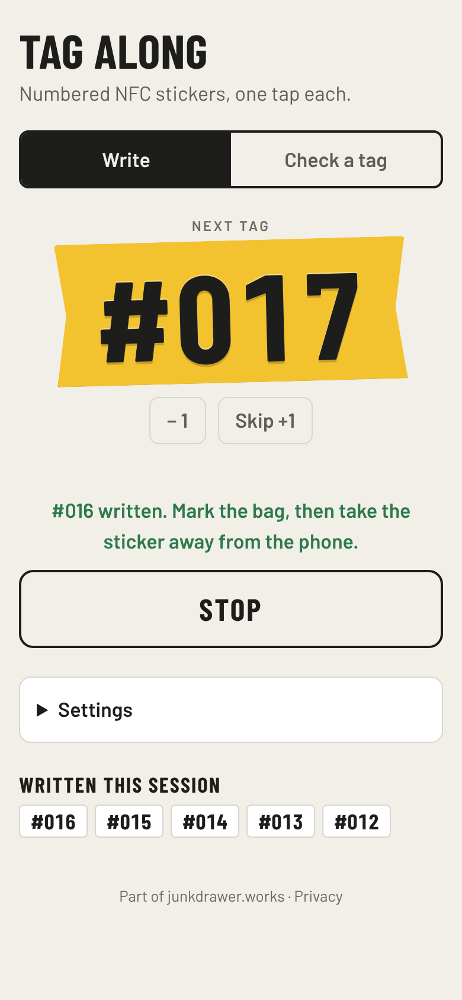
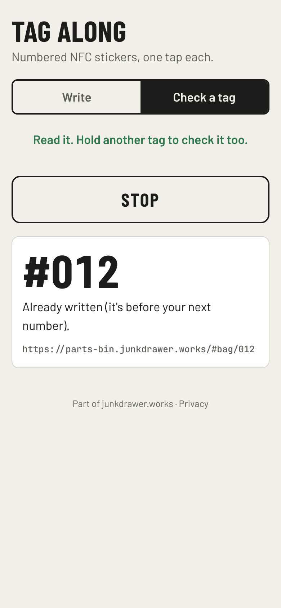

# Tag Along

**Use it: [junkdrawer.works/tag-along](https://junkdrawer.works/tag-along/)** (Chrome on an Android phone)

**Write a run of numbered NFC stickers from your phone, one tap each.** Press Start and hold one blank sticker after another to the back of the phone. Each one gets a link ending in the next number (`…#bag/001`, `…#bag/002`), the phone buzzes, and the number moves on. It's made for labeling a stack of bags, boxes or bins before you know what goes in them.

<p align="center">
  
  
</p>

## How it works

- **One sticker per buzz.** Write mode keeps listening, so you only press Start once. Each sticker gets the next number, and the screen stays on while it runs.
- **Used stickers are left alone.** By default it won't write over a tag that already holds something, which also stops it renumbering the sticker you just wrote if it's still near the phone.
- **Skip and back.** Skip a number (a sticker that tore, say) or step back one to redo it.
- **Check a tag.** Hold any tag to the phone to see what's on it and which number it carries.
- **Any link.** It starts with Parts Bin's bag link, but the part before the number is a setting, as are the start number and how many digits to pad to. A phone that had the old Stockroom link moves to Parts Bin's, and Check still reads the number on a tag written with the old one.
- **Nothing leaves the phone.** The settings and the next number are kept in the browser.

Web NFC only works in Chrome on Android, on a page that is the whole tab (not inside another app's page or frame).

## Running it

It's a static site: plain HTML, CSS and JavaScript, with no build step.

```sh
npx http-server -p 8080 -c-1 .   # then open http://localhost:8080
npm test                         # unit tests, then the page in Chromium with a pretend NFC reader
node tools/screenshots.mjs       # README screenshots and og.png
node tools/make-icons.mjs        # PNG icons from icon.svg
```

GitHub Pages serves it from `main`, `/ (root)`.

### Files

- `index.html`, `css/app.css`: the page.
- `js/app.js`: the write and check loops, talking to Chrome's `NDEFReader`.
- `js/tags.js`: building the link for a number and reading one back, without the phone; unit-tested in `test/tags.test.mjs`.
- `test/e2e.mjs`: drives the page with a pretend NFC reader.
- `fonts/`: Barlow, Barlow Condensed and JetBrains Mono, served from here so nothing loads from elsewhere (SIL Open Font License).
- `sw.js`, `manifest.webmanifest`, `icon*.png`, `icon.svg`: works offline and installs to the home screen.
